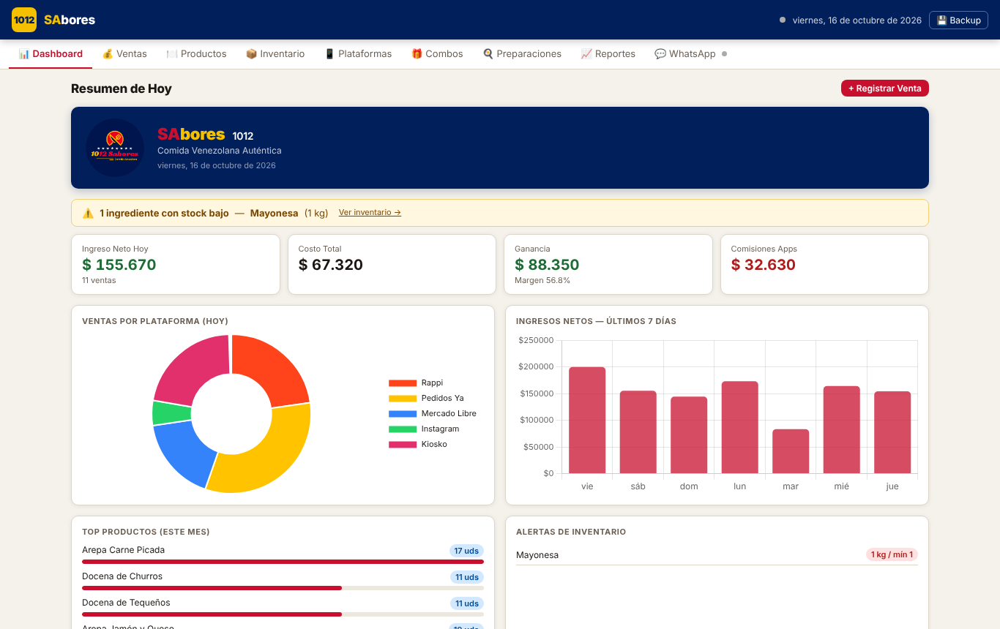
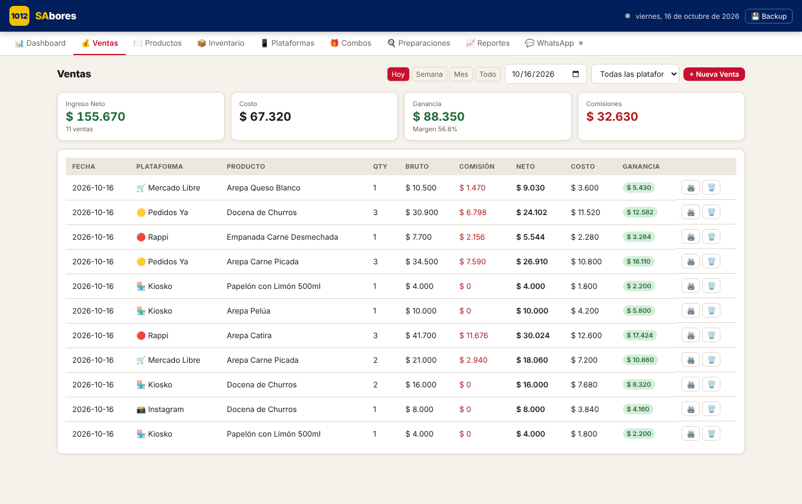
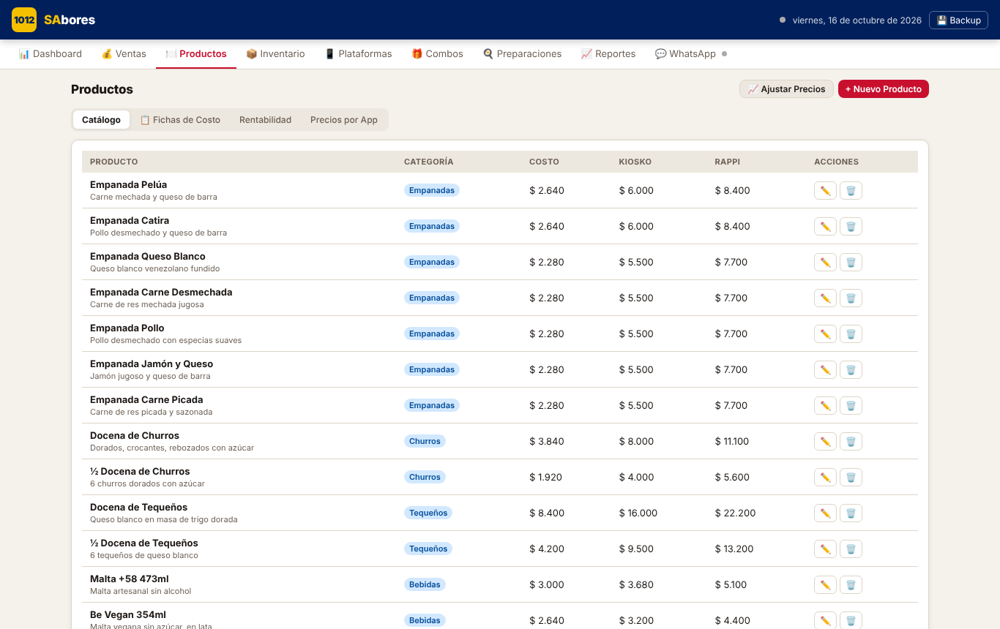
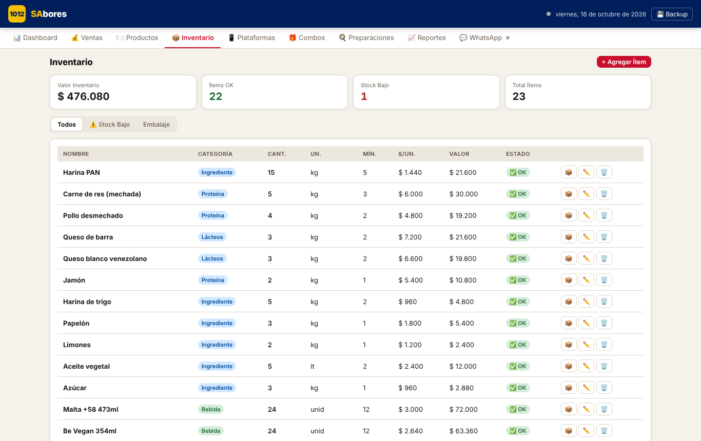
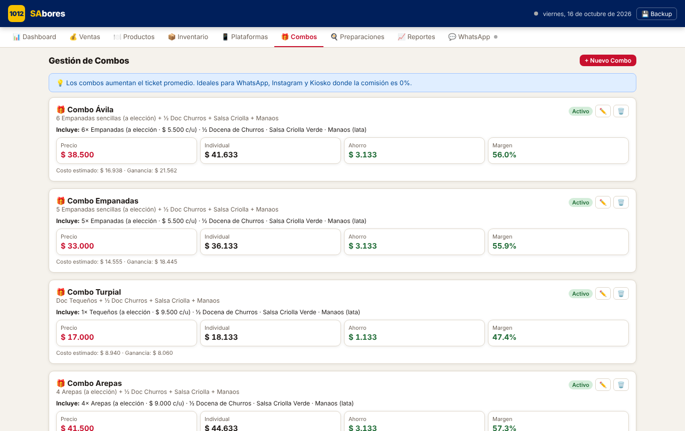
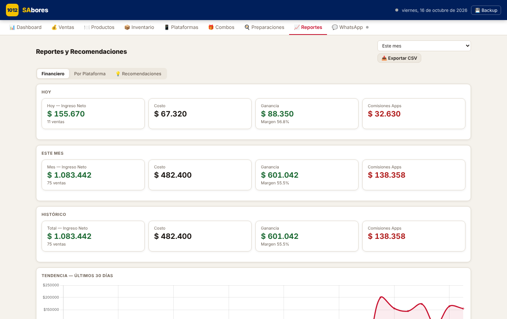
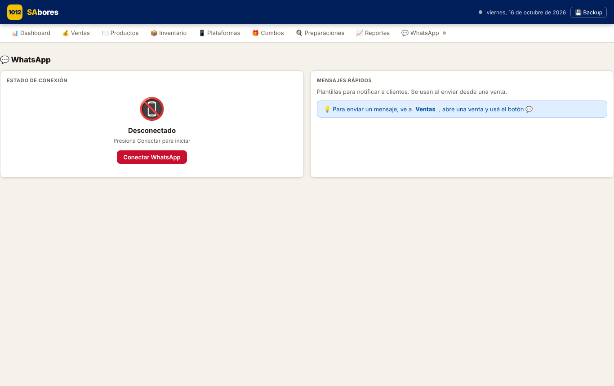

# 1012Sabores

Aplicación de escritorio (Electron) para **gestionar un emprendimiento de comida**: ventas por plataforma con sus comisiones, productos, inventario, combos, recetas y reportes, con envío de mensajes por WhatsApp.

Desarrollada por **Arnulfo José Azuaje Roa** para un negocio real de comida venezolana en Buenos Aires. Los datos incluidos son **de ejemplo**; los costos internos fueron modificados y la configuración de la nube fue retirada.



## Qué resuelve

- Registrar **ventas** por canal (Rappi, PedidosYa, Mercado Libre, WhatsApp, Instagram, kiosco) calculando **comisión y neto** de cada una.
- Conocer el **margen real** de cada producto según la plataforma.
- Controlar el **inventario** y descontarlo automáticamente al vender productos con receta.
- Armar **combos** y **preparaciones** (recetas) con su costo.
- Emitir **tickets en PDF** y sacar **reportes**.
- Hacer **copias de seguridad** en JSON y, opcionalmente, **sincronizar** con Firebase.

## Capturas

| Ventas | Productos |
|---|---|
|  |  |

| Inventario | Combos |
|---|---|
|  |  |

| Reportes | WhatsApp |
|---|---|
|  |  |

## Tecnologías

Electron 31 · electron-builder (instalador NSIS) · JavaScript · HTML/CSS · Chart.js · jsPDF · whatsapp-web.js · Firebase Firestore (opcional) · localStorage

## Módulos

Dashboard · Ventas · Productos · Inventario · Plataformas (comisiones) · Combos · Preparaciones · Reportes · WhatsApp. Incluye además una versión para tablet (`1012Sabores_tablet.html`).

## Puesta en marcha

Requiere [Node.js LTS](https://nodejs.org) (Windows para generar el instalador).

```bash
npm install     # o 1_INSTALAR.bat
npm start       # abre la app (o 3_PROBAR.bat)
npm run build   # genera el instalador en dist/ (o 2_COMPILAR.bat)
npm test        # verificación de sintaxis de main.js y preload.js
```

También se puede abrir `index.html` directamente en un navegador: todo funciona salvo las copias en carpeta y WhatsApp, que requieren Electron.

Los datos se guardan en el navegador/aplicación (`localStorage`, clave `sabores2025`). Las copias de seguridad van a `Documentos/backups_1012sabores/`.

### Sincronización en la nube (opcional)

1. Copie `firebase-config.example.js` como `firebase-config.js` y complete los datos de su proyecto Firebase.
2. **No lo suba al repositorio** (ya está en `.gitignore`).
3. Configure reglas de seguridad en Firestore; sin ellas, cualquiera con la configuración podría leer o escribir.

Sin ese archivo la app funciona solo con datos locales.

## Pruebas realizadas

Verificadas en un navegador automatizado (Playwright) con Electron simulado: carga de los 9 módulos sin errores de JavaScript, registro de una venta desde la interfaz, cálculo de comisión y neto, generación del ticket PDF, copia de seguridad, persistencia al recargar y módulo WhatsApp sin conexión. El descuento de inventario se comprobó con un producto con receta (los productos de ejemplo no traen recetas, por lo que no descuentan stock hasta que se les cargue una).

## Limitaciones

- Cada pantalla vive en un único archivo HTML grande; separarlo en módulos sería la siguiente mejora.
- No hay pruebas automáticas de interfaz en el repositorio.
- El envío por WhatsApp usa `whatsapp-web.js`, una librería **no oficial**: puede dejar de funcionar y su uso automatizado puede violar los términos de WhatsApp. Úselo bajo su responsabilidad.
- Los gráficos, PDF, Firebase y tipografías se cargan desde CDN, por lo que requieren Internet.
- Los costos de ejemplo son ilustrativos.

## Licencia

Sin licencia definida: todos los derechos reservados por el autor.
